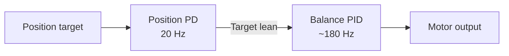

<div align="center">

UBC ELEC 391 · Summer 2026 · Group 11

# Two-Wheel Self-Balancing Robot

A BLE-controlled robot that balances, travels, turns, and climbs a 5° ramp.

Arduino · BMI270 IMU · Cascaded control · Bluetooth LE

[Results](#demo-results) · [Firmware](#firmware) · [Final report](docs/ELEC391_Final_Demo_Report.pdf)


</div>

| **±3 cm** | **< 2 s** | **5° ramp** |
| :---: | :---: | :---: |
| Stopping accuracy over 50 cm | Per 45° turn | Ascent · stop · descent |

## Demo results

| Task | Final demo result |
| :--- | :--- |
| Forward / backward | 50 cm in each direction, stopping within ±3 cm |
| 45° turn | Less than 2 seconds per turn |
| 90° heading | Left within ±3°; right approximately 10° error |
| Ramp tasks | 5° complete; 10° and 15° ascent and stop, with unreliable descent |

Source: [final demo report, Table 10](docs/ELEC391_Final_Demo_Report.pdf) · [Detailed results](docs/RESULTS.md)

## How it works

The robot behaves as an inverted pendulum. Encoder feedback sets a target lean angle, while a faster IMU-based balance loop drives the wheels beneath the body.



The IMU's complementary tilt estimate feeds the balance loop; wheel encoders feed the position loop. Gyro-based yaw control adds a left/right correction before motor deadband compensation and PWM output.

**Hardware:** Arduino Nano 33 BLE Sense with BMI270, two encoder-equipped DC motors, two DRV8871 drivers, and a 12 V supply.

[Hardware, wiring & control details](docs/HARDWARE_AND_CONTROL.md) · [BLE commands](docs/BLE_COMMANDS.md)

## Firmware

| Sketch | Purpose |
| :--- | :--- |
| [`final_requirement_balance_robot`](firmware/final_requirement_balance_robot/final_requirement_balance_robot.ino) | Baseline balance, position control, and preset ramp sequence |
| [`TURNING`](firmware/TURNING/TURNING.ino) | Direction-specific yaw control and automatic two-step turns |

Open and upload **one sketch at a time**.

<details>
<summary><strong>Quick start</strong></summary>

1. Clone this repository:

   ```bash
   git clone https://github.com/zgao36/ELEC391_Self_Balancing_Robot.git
   ```

2. In Arduino IDE, install **Arduino Mbed OS Nano Boards** and select the board entry matching your Nano 33 BLE Sense hardware. The firmware uses the **Nano 33 BLE Sense Rev2** BMI270 sensor library.
3. Install **Arduino_BMI270_BMM150** and **ArduinoBLE** through Library Manager.
4. Open one of the sketches linked above.
5. Verify the [motor and encoder connections](docs/HARDWARE_AND_CONTROL.md#connections), then compile and upload.
6. Open Serial Monitor at **115200 baud**. Keep the robot stationary during gyro calibration, then support it close to the upright target until it arms.
7. Connect a BLE client to **`BLE-DEVICE111`** and use the [BLE command reference](docs/BLE_COMMANDS.md) for the selected sketch.

</details>

## Contributors

| Team member | Contact |
| :--- | :--- |
| [Peter Gao](https://github.com/zgao36) | [gztgzt6@gmail.com](mailto:gztgzt6@gmail.com) |
| [Tony Zhao](https://github.com/RanDom1513) | [tonyzpb@gmail.com](mailto:tonyzpb@gmail.com) |
| [Echo Zhou](https://github.com/Echo3516) | [zhou3516n@gmail.com](mailto:zhou3516n@gmail.com) |
| [Rita Chang](https://github.com/Ritazlx) | [ritachang0210@gmail.com](mailto:ritachang0210@gmail.com) |
