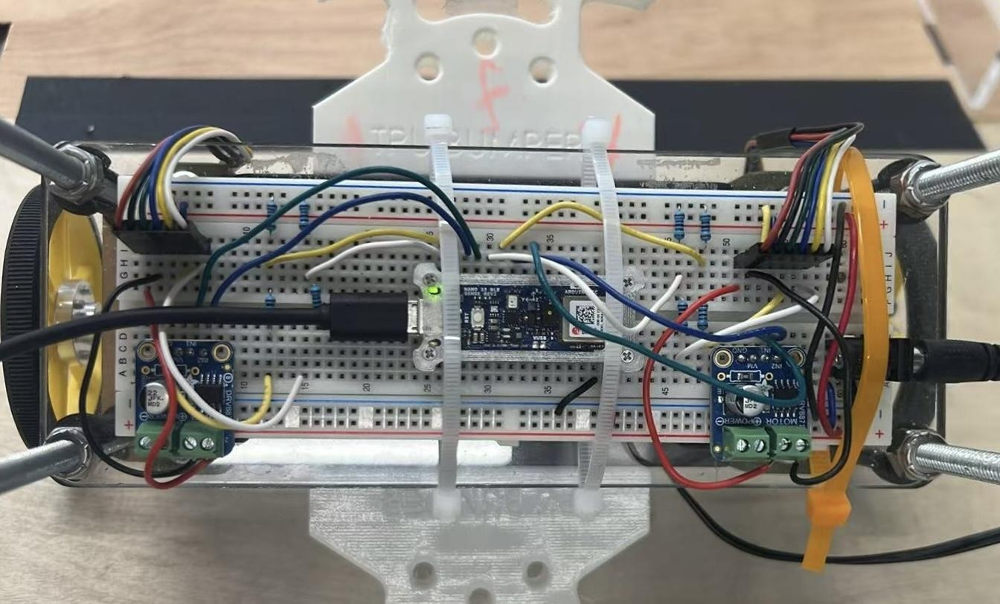
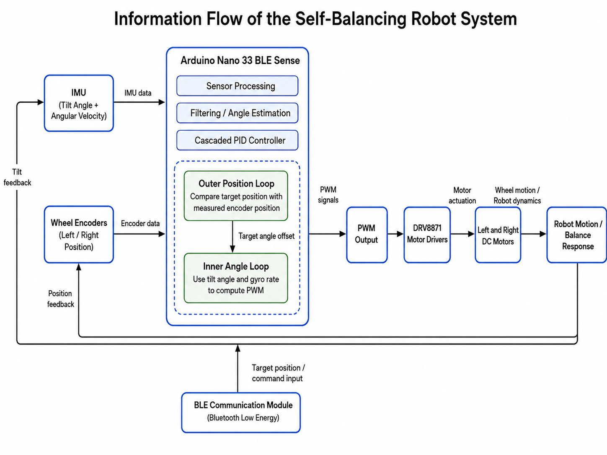

<div align="center">

# Two-Wheel Self-Balancing Robot

A BLE-controlled inverted-pendulum robot built for **UBC ELEC 391 · Summer 2026 · Group 11**.


[Quick start](#quick-start) · [BLE commands](docs/BLE_COMMANDS.md) · [Hardware & control](docs/HARDWARE_AND_CONTROL.md) · [Demo results](docs/RESULTS.md) · [Final report](docs/ELEC391_Final_Demo_Report.pdf)



</div>

## Overview

This two-wheel robot balances by continuously moving its wheels beneath its center of mass. An onboard BMI270 IMU estimates body tilt, wheel encoders measure travel, and cascaded controllers turn position commands into a target lean angle and motor PWM. A phone or computer sends movement commands over Bluetooth Low Energy.

## Final demo highlights

| Task | Reported result |
| :--- | :--- |
| Forward and backward travel | 50 cm in each direction; stopping error within **±3 cm** |
| Individual 45° turns | **Less than 2 seconds** per turn |
| Left 90° turn | Final heading within **±3°** |
| Right 90° turn | Approximately **10° error**; accuracy target not met |
| 5° ramp | Completed ascent, stop, and descent while balancing |
| 10° and 15° ramps | Climbed and stopped; descent remained unreliable |

Results from the [final demo report](docs/ELEC391_Final_Demo_Report.pdf), Table 10.

## How it works

<p align="center">
  
</p>

- **Tilt estimation:** 400 Hz accelerometer/gyroscope configuration, 500-sample automatic bias calibration, and a complementary filter with `K = 0.98`.
- **Balance:** inner PID loop, scheduled at approximately **180 Hz**.
- **Position:** a **20 Hz** encoder-based PD loop sets a bounded lean-angle offset; position targets ramp at 12 cm/s.
- **Turning:** differential motor commands provide yaw control. The baseline uses a P controller; the turning variant adds direction-specific PD control and automatic two-step turns.
- **Wireless commands:** BLE is polled after every 20 control cycles so command handling stays outside the inner control calculation.

## Hardware

| Component | Purpose |
| :--- | :--- |
| Arduino Nano 33 BLE Sense with BMI270 IMU | Control, inertial sensing, and built-in BLE |
| Two DC gear motors with quadrature encoders | Actuation and wheel-position feedback |
| Two DRV8871 motor drivers | Bidirectional PWM motor drive |
| 12 V supply / battery pack | Robot power |
| 8 cm wheels and two-level chassis | Two-wheel inverted-pendulum platform |
| Encoder voltage dividers | Interface encoder signals to 3.3 V logic |

The firmware uses the **Nano 33 BLE Sense Rev2** BMI270 sensor library.

## Firmware layout

```text
ELEC391_Self_Balancing_Robot/
├── firmware/
│   ├── final_requirement_balance_robot/
│   │   └── final_requirement_balance_robot.ino
│   └── TURNING/
│       └── TURNING.ino
├── docs/
│   ├── assets/
│   ├── BLE_COMMANDS.md
│   ├── HARDWARE_AND_CONTROL.md
│   ├── RESULTS.md
│   └── ELEC391_Final_Demo_Report.pdf
└── README.md
```

| Sketch | Use it for | Main behavior |
| :--- | :--- | :--- |
| [`final_requirement_balance_robot`](firmware/final_requirement_balance_robot/final_requirement_balance_robot.ino) | Baseline balance, travel, and ramp tasks | Balance PID, position PD, P-only yaw, preset ramp sequence |
| [`TURNING`](firmware/TURNING/TURNING.ino) | Direction-specific turning experiments | Yaw PD, heading hold, rate damping, automatic two-step left/right turns |

Open and upload **one sketch at a time**.

## Quick start

1. Clone this repository:

   ```bash
   git clone https://github.com/zgao36/ELEC391_Self_Balancing_Robot.git
   ```

2. In Arduino IDE, install the **Arduino Mbed OS Nano Boards** package and select the board entry matching your Nano 33 BLE Sense hardware.
3. Install **Arduino_BMI270_BMM150** and **ArduinoBLE** through Library Manager.
4. Open `firmware/final_requirement_balance_robot/final_requirement_balance_robot.ino` for the baseline, or `firmware/TURNING/TURNING.ino` for the turning variant.
5. Check motor and encoder wiring against the [firmware pin table](docs/HARDWARE_AND_CONTROL.md#connections), then verify and upload the selected sketch.
6. Open Serial Monitor at **115200 baud**. Keep the robot stationary during automatic gyro calibration. After calibration, support it close to the upright target until the controller arms.
7. Connect a BLE client to **`BLE-DEVICE111`** and write a command to the custom characteristic described in [BLE commands](docs/BLE_COMMANDS.md).

See [hardware and control](docs/HARDWARE_AND_CONTROL.md) for pin assignments, control gains, and startup behavior.

## Contributors

| Team member | Contact |
| :--- | :--- |
| Peter Gao | [@zgao36](https://github.com/zgao36) |
| Tony Zhao | [tonyzhao1312@gmail.com](mailto:tonyzhao1312@gmail.com) |
| [Echo Zhou](https://github.com/Echo3516) | [zhou3516n@gmail.com](mailto:zhou3516n@gmail.com) |
| [Rita Chang](https://github.com/Ritazlx) | [ritachang0210@gmail.com](mailto:ritachang0210@gmail.com) |

## Engineering lessons

- **Make the measurements trustworthy first.** A rigid IMU mount and repeatable calibration reduced drift before gain tuning.
- **Treat the motors separately.** Measured deadbands of 41 and 42 PWM counts improved low-speed response, but did not remove turning asymmetry.
- **Tune from the inside out.** Stabilize balance, then position, then turning and ramp behavior.
- **Separate climbing from descent.** Successful uphill motion did not establish reliable downhill speed control on steeper ramps.
